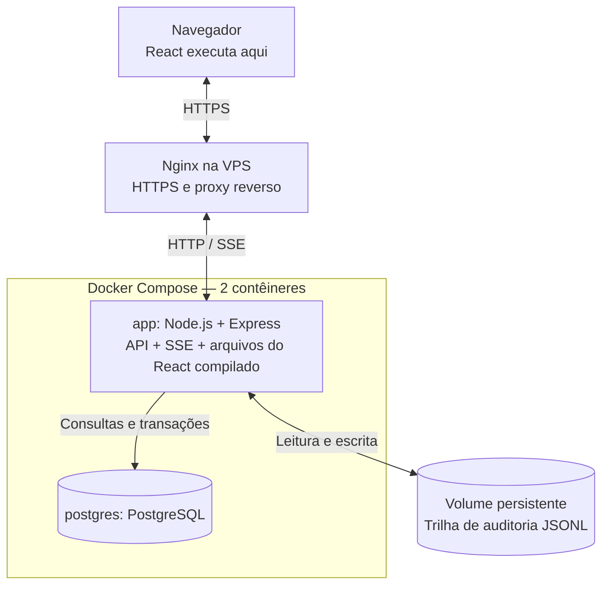

# Casa de Leilões

Plataforma de leilões com publicação de lotes, disputas em tempo real, carteiras simuladas e auditoria pública de lances. **Leiloeiros** criam e acompanham lotes; **licitantes** ofertam e consultam suas participações; visitantes acompanham as disputas.

## Do entendimento à implementação

O [Documento de Requisitos](docs/REQUISITOS.pdf) apresenta o glossário,
escopo, priorização, histórias de usuário, critérios de aceitação e
cenários que orientaram o desenvolvimento do AuctionHouse.

O desenvolvimento começou pela compreensão do negócio: identificação das entidades, documento de requisitos, histórias de usuário, critérios de aceitação e cenários essenciais. **A escolha das tecnologias veio depois da definição dos comportamentos esperados.** O prazo de sete dias orientou decisões de escopo e simplicidade, registradas em [Decisões e limites](docs/DECISOES.md).

## Tecnologias

| Backend | Frontend | Persistência e testes |
| --- | --- | --- |
| Node.js 22, TypeScript, Express 4, JWT | React 19, Vite 7, React Router 7, Bootstrap 5 | PostgreSQL 16, Drizzle ORM, Vitest |

As versões instaladas são determinadas pelo `package-lock.json`.

## Arquitetura de implantação



**Por quê?** A aplicação e o banco têm ciclos de vida separados, enquanto Express e React compilado são publicados juntos para reduzir complexidade. O React **executa no navegador**; o Express apenas entrega seus arquivos. **Nginx/HTTPS representam a implantação planejada na VPS**, não um deploy já confirmado.

[Arquitetura e estrutura do backend e frontend](docs/ARQUITETURA.md)

## Executar com Docker

**Pré-requisitos:** Docker com Compose. Na raiz do projeto:

```bash
cp .env.example .env
```

Configure `POSTGRES_DB`, `POSTGRES_USER`, `POSTGRES_PASSWORD`, `JWT_SECRET`, `AUDITORIA_CHAVE_HEX` e `DEMO_PASSWORD`. Gere os **dois segredos separadamente**:

```bash
openssl rand -hex 32   # JWT_SECRET
openssl rand -hex 32   # AUDITORIA_CHAVE_HEX
```

Não versione o `.env` e **preserve a chave de auditoria**: substituí-la impede a verificação dos registros anteriores.

```bash
docker compose up -d postgres
docker compose build app
docker compose run --rm app npm run db:migrate
docker compose run --rm app npm run db:seed
docker compose up -d app
```

Acesse **http://localhost:3001**. O Compose mantém o PostgreSQL e o diretório de auditoria em armazenamento persistente.

**Contas de demonstração:** `guilhermealmeida@demo.com`, `anasouza@demo.com` e `brunolima@demo.com`, com a senha informada em `DEMO_PASSWORD`.

Para execução sem o contêiner da aplicação, configuração de ambiente e diagnóstico, consulte [Execução e testes](docs/EXECUCAO.md).

## Publicação

O deploy utiliza GitHub Actions para validar a aplicação, publicar
a imagem Docker no GHCR e atualizar a versão na VPS.

A infraestrutura utiliza Docker Compose e Nginx como proxy reverso
com HTTPS.

[Consultar o guia de publicação na VPS](docs/DEPLOY.md)

## Testes

```bash
npm run check
npm run test
npm run test:coverage
npm run test:integration
npm run build
```

**Atenção:** a integração exige `.env.test` com banco `casa_leiloes_test` e auditoria isolada; consulte as instruções antes de executá-la. O comando de cobertura mede os **testes de domínio**, não toda a aplicação. [Detalhes e espaço para imagem de cobertura](docs/EXECUCAO.md#testes-e-cobertura).

## Decisões e limites

As escolhas sobre **Repository Pattern simplificado**, **prorrogação única**, **saldo comprometido** e **auditoria HMAC** estão documentadas com justificativas e consequências, incluindo perguntas que exigiriam refinamento com cliente/PO.

[Consultar decisões técnicas, regras de negócio e limites](docs/DECISOES.md)