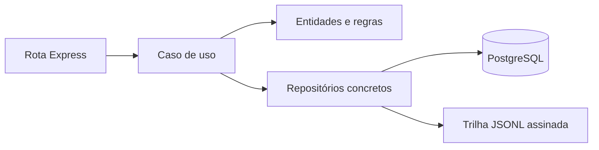
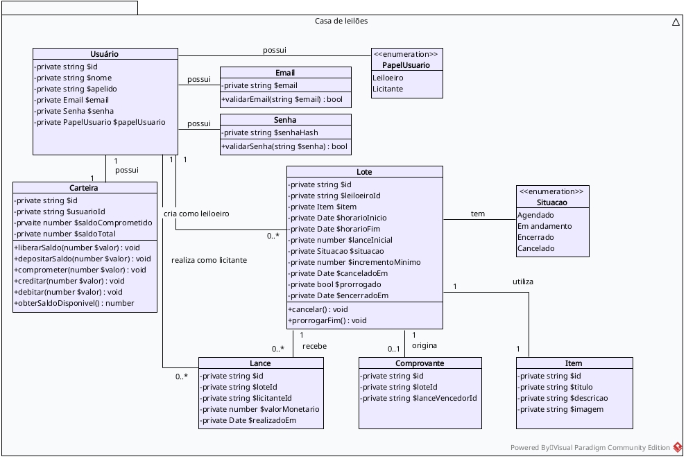

# Arquitetura e responsabilidades

[← Voltar ao README](../README.md)

## Backend

### Estrutura

```text
backend/
├── main.ts                 # Inicialização HTTP e processamento periódico
└── src/
    ├── domain/             # Entidades, Value Objects e regras próprias
    ├── application/        # Casos de uso que coordenam operações
    ├── infrastructure/     # Banco, repositórios, auditoria, SSE e jobs
    └── http/               # Rotas, JWT e autorização
```

### Arquitetura



**Responsabilidade:** o HTTP recebe e responde; o caso de uso coordena; a entidade valida; a infraestrutura persiste. Transações e bloqueios de registros protegem as operações críticas de lances e carteiras.

### Modelagem de entidades



<!-- Quando o diagrama for adicionado, substituir a linha acima por:

-->

## Frontend

### Estrutura

```text
frontend/src/
├── App.tsx                # Rotas e navegação
├── pages/                 # Vitrine, sala, carteira, participações e painéis
├── components/            # Cabeçalho compartilhado
├── api/                   # Cliente HTTP e endpoints
├── styles/                # Estilos da interface
├── types.ts               # Contratos consumidos pelas telas
└── formatacao.ts          # Valores, datas e horário
```

### Arquitetura

O React apresenta o estado, navega e envia comandos à API; **não decide se um lance é válido nem movimenta saldo**. Na sala de leilão, eventos SSE avisam sobre mudanças e o frontend consulta novamente a API. Há ressincronização periódica como alternativa a eventos perdidos.

**Privacidade:** o histórico público mostra identificadores anônimos por lote; a área autenticada pode mostrar o nome do titular e seu papel. Hoje os rótulos públicos seguem o formato `Licitante 1`, `Licitante 2`.

## Implantação

O `compose.yml` reúne **app** (Express + React compilado + SSE) e **postgres**. O PostgreSQL utiliza um volume Docker; a auditoria utiliza um diretório persistido no host.

Na VPS, a topologia **prevista** utiliza Nginx como entrada HTTPS e proxy reverso para o contêiner `app`. A publicação da porta da aplicação deve ficar restrita ao host, e a conexão SSE precisa atravessar o proxy sem buffering. Não é necessária uma instância separada para servir o React neste estágio.

[Consultar o processo de publicação](DEPLOY.md)

[← Voltar ao README](../README.md)
