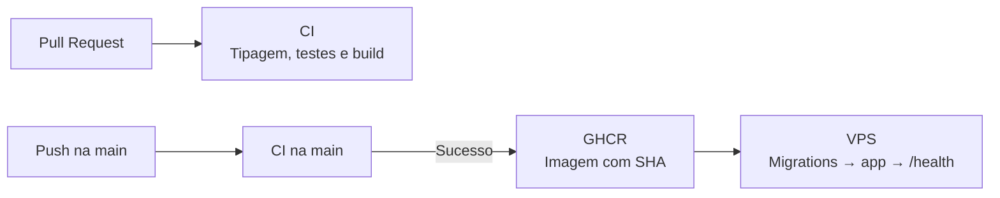

# Publicação na VPS

[← Voltar ao README](../README.md)

A publicação é automatizada pelo GitHub Actions. A imagem da aplicação é versionada no GHCR; o PostgreSQL e a trilha de auditoria permanecem na VPS.

## Fluxo de publicação



O deploy ocorre **somente após o CI de um push na `main` passar**. A VPS recebe a imagem identificada pelo SHA do commit; não compila a aplicação.

## Infraestrutura

| Componente | Responsabilidade |
| --- | --- |
| **Nginx (host)** | HTTPS e proxy reverso, incluindo conexões SSE sem buffering. |
| **`app` (contêiner)** | Express, API, SSE e entrega dos arquivos compilados do React. |
| **`postgres` (contêiner)** | Dados transacionais, em volume persistente. |
| **`.dados/auditoria` (host)** | Trilha JSONL assinada, preservada entre versões. |

O Express utiliza a porta interna 3001, publicada em 127.0.0.1:3002 na VPS. Essa configuração restringe o acesso direto à aplicação ao próprio host, permitindo que um proxy reverso gerencie sua exposição externa.

A aplicação é disponibilizada pelo domínio [leiloes.guilhermealamino.com.br](https://leiloes.guilhermealamino.com.br), utilizando Nginx como proxy reverso para o serviço Express executado no Docker.

[Ver diagrama de arquitetura](../README.md#arquitetura-de-implantação)

## Preparação inicial

1. Na VPS, disponibilize Docker Engine, Compose, Nginx e acesso SSH. Prepare `/var/www/AuctionHouse` e `.dados/auditoria`, com permissões para o usuário de deploy e para a aplicação.
2. Crie **`.env.production` somente na VPS**, com `POSTGRES_DB`, `POSTGRES_USER`, `POSTGRES_PASSWORD`, `DATABASE_URL`, `DEMO_PASSWORD`, `JWT_SECRET` e `AUDITORIA_CHAVE_HEX`. A conexão interna usa `postgres:5432`. Proteja o arquivo com `chmod 600 .env.production`.
3. Gere chaves distintas para JWT e auditoria:

   ```bash
   openssl rand -hex 32   # JWT_SECRET
   openssl rand -hex 32   # AUDITORIA_CHAVE_HEX
   ```

4. No repositório GitHub, cadastre os secrets `VPS_HOST`, `VPS_USER`, `VPS_PORT` e `VPS_SSH_KEY`. O usuário SSH precisa conseguir executar o Docker Compose.
5. Se a imagem GHCR for privada, configure na VPS um token com `read:packages`. Configure o Nginx com HTTPS apontando para `http://127.0.0.1:3002` e `proxy_buffering off;` para SSE.

## Primeira publicação

Após preparar a VPS, faça o push na `main` com o CI aprovado. O workflow copia `compose.prod.yml`, baixa a imagem, inicia o banco se necessário, aplica migrations e atualiza somente o serviço `app`.

Opcionalmente, crie os usuários e o lote demonstrativos **uma única vez**:

```bash
cd /var/www/AuctionHouse
docker compose -f compose.prod.yml \
  --env-file .env.production --env-file .env.deploy \
  run --rm app npm run db:seed
```

Verifique a aplicação e os logs:

```bash
curl -fsS http://127.0.0.1:3002/health
docker compose -f compose.prod.yml \
  --env-file .env.production --env-file .env.deploy \
  logs --tail=100 app
```

## Limites operacionais

- **Rollback:** recupera a imagem anterior se existir, mas **não reverte migrations**. Mantenha alterações de banco compatíveis e faça backup antes de mudanças destrutivas.
- **Persistência:** preserve o volume PostgreSQL, os arquivos JSONL e a chave HMAC. Não execute `docker compose down -v` em produção.
- **Escala:** a aplicação opera com uma instância da API; SSE e processamento periódico utilizam recursos locais dessa instância.
- **Testes:** o CI utiliza banco e auditoria isolados. Nunca aponte os testes de integração para dados de produção.

[← Voltar ao README](../README.md)