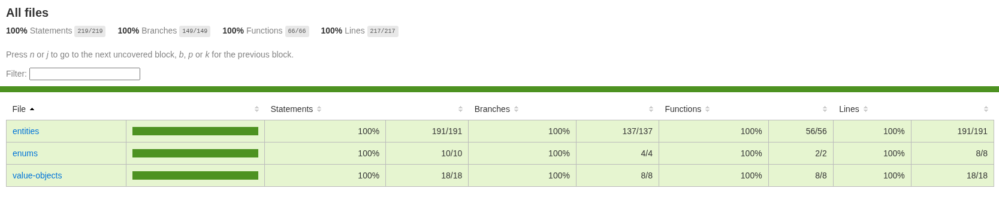

# Execução, testes e evidências

[← Voltar ao README](../README.md)

## Pré-requisitos

- **Docker + Compose** para subir a aplicação e o PostgreSQL.
- **Node.js 22.12+ e npm** para desenvolvimento e testes no host.

## Configuração

Na raiz do projeto:

```bash
cp .env.example .env
```

| Variável | Uso |
| --- | --- |
| `POSTGRES_DB`, `POSTGRES_USER`, `POSTGRES_PASSWORD` | Inicialização do PostgreSQL |
| `DATABASE_URL` | Acesso ao banco no host (`127.0.0.1:5433`) |
| `JWT_SECRET` | Assinatura de tokens JWT |
| `AUDITORIA_CHAVE_HEX` | Chave de 32 bytes para HMAC, representada por 64 caracteres hexadecimais |
| `AUDITORIA_DIRETORIO` | Diretório absoluto para a execução local no host |
| `DEMO_PASSWORD` | Senha das contas criadas pelo seed |

Gere **um segredo diferente para cada finalidade**:

```bash
openssl rand -hex 32  # copiar para JWT_SECRET
openssl rand -hex 32  # copiar para AUDITORIA_CHAVE_HEX
```

O Compose fornece ao `app` a conexão interna `postgres:5432` e o diretório de auditoria `/app/.dados/auditoria`. No host, a conexão utiliza `127.0.0.1:5433`. Se a senha do banco tiver caracteres reservados de URL, codifique-os na string de conexão. Nunca versione o `.env`.

## Docker: aplicação completa

```bash
docker compose config --quiet
docker compose up -d postgres
docker compose build app
docker compose run --rm app npm run db:migrate
docker compose run --rm app npm run db:seed
docker compose up -d app
docker compose ps
```

Aplicação em **http://localhost:3001**. Para inspecionar falhas: `docker compose logs --tail=100 app`.

**Persistência:** volume `postgres_data` e diretório `.dados/auditoria`. Não execute `docker compose down -v` se quiser preservar o banco; preserve também `AUDITORIA_CHAVE_HEX` e faça backup da trilha.

## Desenvolvimento no host

```bash
npm ci
docker compose up -d postgres
npm run db:migrate
npm run db:seed
```

Em dois terminais:

```bash
npm run dev:server  # API: http://localhost:3001
npm run dev         # Frontend: http://localhost:5173
```

O `db:reset` é destrutivo e protegido para ambiente local. Não o execute dentro do serviço `app` configurado com `NODE_ENV=production`.

## Testes e cobertura

```bash
npm run check
npm run test
npm run test:coverage
npm run build
```

**Integração:** copie `.env.test.example` para `.env.test`. O exemplo disponível precisa ser completado com uma `AUDITORIA_CHAVE_HEX` válida e `AUDITORIA_DIRETORIO` absoluto, isolado e terminado em `auditoria-test`. `DATABASE_URL` deve apontar exclusivamente para **`casa_leiloes_test`**.

```bash
cp .env.test.example .env.test
# Editar .env.test antes de executar
npm run test:integration
```

O comando prepara o banco e executa testes que limpam seus registros. **Nunca use o banco de desenvolvimento ou produção para integração.** `test:coverage` mede os testes de domínio; nenhum percentual é declarado sem o relatório de execução.


